# Geo Trio II serial tap: local smart meter data for Home Assistant

Live electricity, gas, costs and the **tariff itself**, read straight from a Geo Trio II in-home display by an ESP32-C3 hidden in its battery bay. No cloud, no account, no API keys. It keeps working when the internet doesn't.

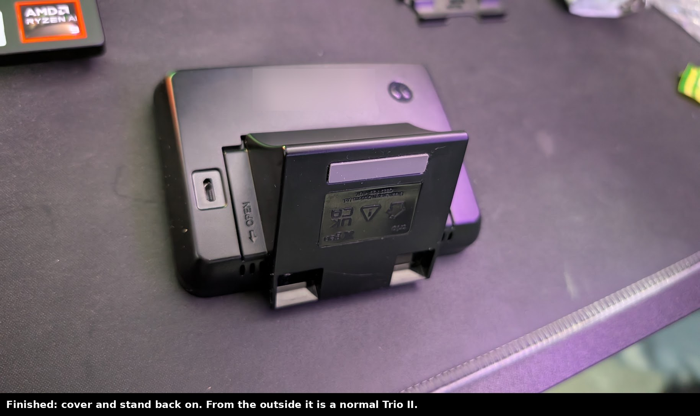

This repo documents what I did to my own Trio II (the **2022 board revision, T2CO-A-PCB-001_3**): working out the serial data, finding usable test points on a board that differs from the documented 2017 one, soldering it in, decoding the protocol (including the tariff, which I haven't seen decoded anywhere else), and wiring it all into Home Assistant's Energy dashboard.

It builds on [nadnerb33/geotrio2mqtt](https://github.com/nadnerb33/geotrio2mqtt), who found that the Trio II's Zigbee chip talks to the rest of the IHD over a UART you can listen to. Go and star it.

> **Disclaimer.** This means opening and soldering to a device that talks to your energy meters. It's receive-only and can't change anything on the meter, but you do it at your own risk. My Trio II is my own (bought as the Drayton Wiser Insights+ add-on), not one loaned by an energy supplier. Check yours is yours before modifying it.

---

## Quick start

Just want it working? This is everything, in order. The rest of this page explains how and why.

1. **Check your board.** Remove the back of the Trio II. This was done on **T2CO-A-PCB-001_3 (© 2022)**; the 2017 board (TR2L) works the same way but grounds differently (see [geotrio2mqtt](https://github.com/nadnerb33/geotrio2mqtt)).
2. **Get the parts.** An ESP32-C3 SuperMini, some 30 AWG wire, a soldering iron and flux, a multimeter, insulating tape.
3. **Flash the C3 first, over USB.** Put the three files from [`firmware/`](firmware/) in your ESPHome config folder, copy [`secrets.example.yaml`](firmware/secrets.example.yaml) into your `secrets.yaml` and fill it in, then ESPHome Builder → Install → Plug into this computer.
4. **Wire three points** (IHD unplugged):

   | Trio II | ESP32-C3 |
   |---|---|
   | **J8 pin 1** (TX, nearest the "J8" label) | **GPIO20** |
   | **TP69** (next to the micro-USB) | **5V** |
   | **BT2** battery contact | **G** |

   Photo: [where each one is](images/board-2022-tap-points.jpg). Leave the C3's TX unconnected.
5. **Check with a multimeter** before powering: each wire beeps end to end; **5V to G must not beep**.
6. **Insulate and fit.** Tape under and over the C3, tape every joint, tuck it in the battery bay, cover on.
7. **Plug the IHD in.** Within a minute Home Assistant finds "Geo Trio Tap". Check: **Tariff source** = `meter`, **Damaged frames rejected** ≈ 0.
8. **Energy dashboard** (Settings → Dashboards → Energy):
   - Electricity: `Electricity meter`, price from `Electricity unit rate`, live power `Electricity power`.
   - Gas: `Gas meter (kWh)`, price from `Gas unit rate`.

That's it. Updates after that are wireless.

---

## Contents

0. [Quick start](#quick-start)
1. [Why](#why)
2. [What you get](#what-you-get)
3. [How it works](#how-it-works)
4. [Hardware](#hardware): parts, the 2022 board, finding the points, test, solder, install
5. [The protocol](#the-protocol): framing, checksum, endpoints, attributes
6. [Decoding the tariff](#decoding-the-tariff)
7. [The ESPHome firmware](#the-esphome-firmware)
8. [Home Assistant](#home-assistant)
9. [Things I learned the hard way](#things-i-learned-the-hard-way)
10. [Open questions](#open-questions)

Detailed references: [docs/hardware.md](docs/hardware.md) · [docs/protocol.md](docs/protocol.md) · [docs/home-assistant.md](docs/home-assistant.md) · [docs/reverse-engineering.md](docs/reverse-engineering.md)

---

## Why

Geo retired the Geo Home app and its cloud API in October 2026. Accounts dropped off one by one, and with them every Home Assistant integration that relied on it. The Trio II itself kept working, though: it still talks to the meters over Zigbee and still shows everything on its screen. The data was all still there, just not reachable.

The goal: get that data out **locally**, with no dependence on Geo, my supplier, or any cloud, without breaking anything the IHD already does (mine also feeds Drayton Wiser Insights+, which still works).

## What you get

All of this updates locally in Home Assistant, and all of it matched the IHD's own screen, to the penny, before I trusted it:

| | Electricity | Gas |
|---|---|---|
| Live power | **every ~10 s** | **estimated** from the meter's half-hourly readings (kW) |
| Meter reading | kWh, full resolution | m³, plus a **kWh running total** safe for the Energy dashboard |
| Today / yesterday / this month | kWh and £ (incl. standing charge) | kWh and £ (incl. standing charge) |
| Tariff, **from the meter** | unit rate, standing charge | unit rate, standing charge, volume correction factor, calorific value |

Plus diagnostics: meter-link status messages from the IHD's Zigbee chip, a damaged-frame counter and log, a "new message kind" detector, board temperature, a stale-data alarm.

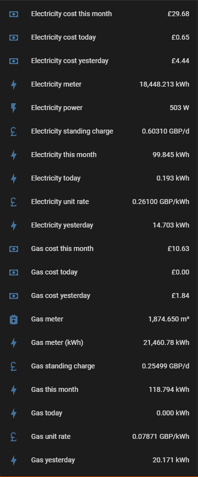

## How it works

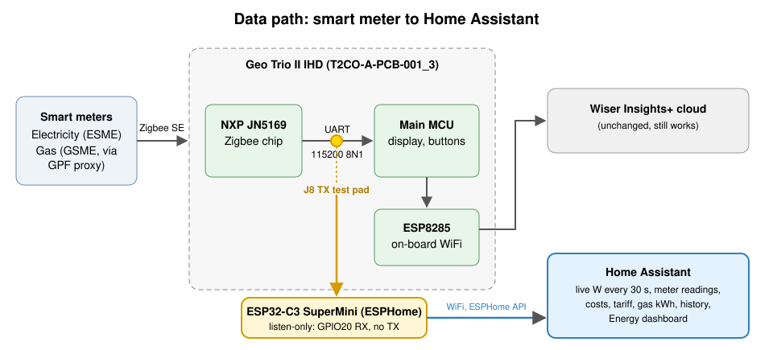

Inside the Trio II, an **NXP JN5169** Zigbee chip receives everything from the meters and passes it to the IHD's main processor over a serial line (115200 baud, 8N1). That serial line's transmit pin is exposed on a test pad, **J8**. An ESP32-C3 listens on that pad, and only listens: its own TX pin is left unconnected, so nothing can ever be sent back into the IHD.

The C3 runs [ESPHome](https://esphome.io) with a small C++ decoder, and talks to Home Assistant over ESPHome's native API.

## Hardware

### Parts

- An **ESP32-C3 SuperMini** (any ESP32 works; the SuperMini is tiny enough for the battery bay)
- 30 AWG silicone wire, flux, a fine-ish soldering iron
- A multimeter with a continuity beep
- Insulating tape (Kapton is best; PVC electrical tape works)

### The 2022 board is different

The geotrio2mqtt docs describe the 2017 board. Mine is **T2CO-A-PCB-001_3, © 2022**. The Zigbee side is the same (JN5169, J8 in the same place, same data), but:

- **WiFi is built in** (an ESP8285 on the main board). There's no separate WiFi module header.
- **There's no ground pad next to C1.** I used the **BT2 battery contact** instead.
- **5 V** is on test point **TP69**, right beside the micro-USB socket.

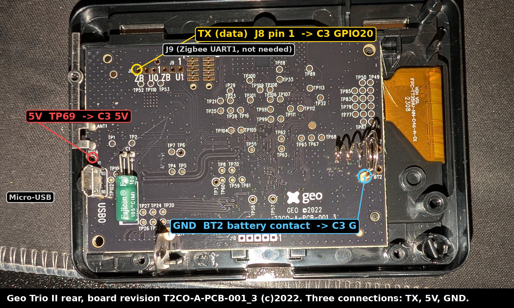

| Trio II | ESP32-C3 SuperMini | Notes |
|---|---|---|
| **J8 pin 1** (Zigbee UART0 TX) | **GPIO20** | 3.3 V logic, idles high, jitters with data |
| **TP69** | **5V** | 5.08 V measured, from the USB input |
| **BT2** battery contact | **G** | continuity to the USB shell and C1 − |

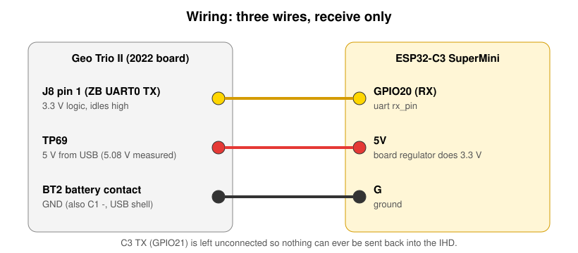

### Find the points with a meter first

Don't take my word for which pad is which; measure yours. With the IHD powered from USB:

1. **Ground**: continuity (beep) between the BT2 contact and the micro-USB shell.
2. **5 V**: TP69 to ground reads ~5 V.
3. **J8**: one pad reads 0 V, one a steady 3.3 V, and one around 3.3 V that **flickers** on the meter. The flickering one is TX. On my board that was pin 1, the pad nearest the "J8" label.

More detail, and photos of each measurement, in [docs/hardware.md](docs/hardware.md).

### Test before you solder

I proved it worked with jumper wires *held* against J8 and the BT2 contact, the C3 powered from my PC, running the [stage-1 raw logger](firmware/stage1-raw-logger.yaml). Frames appeared straight away. I then captured ~70 minutes of data over three sessions (**6,811 frames**), which is what the decoding is built from.

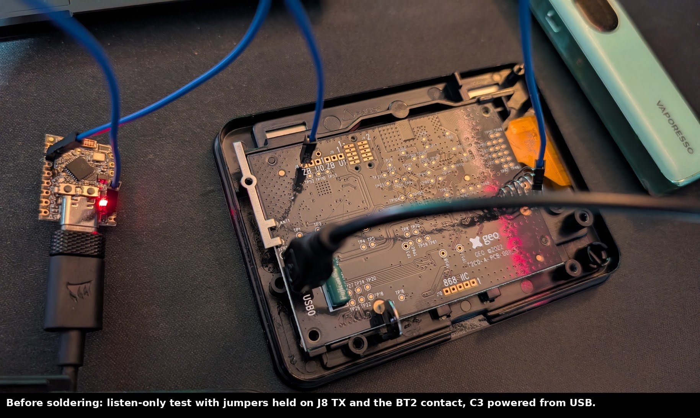

### Solder

Practise on a spare board first. Flux, a quick touch with the iron, and don't linger on J8: those pads are small.

| 5 V on TP69 | GND on BT2 | TX on J8 pin 1 |
|---|---|---|
| 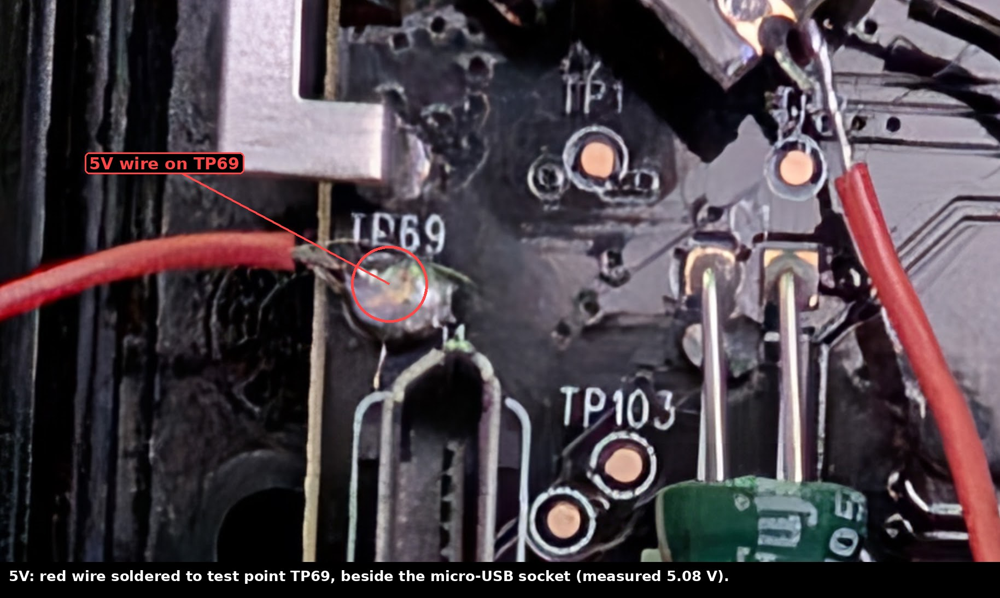 | 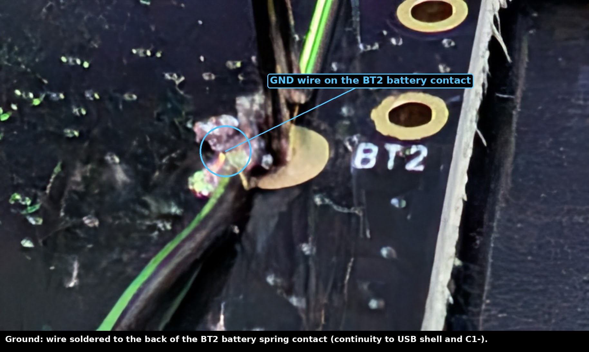 | 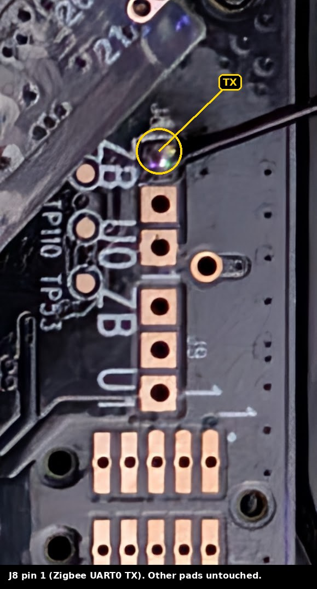 |

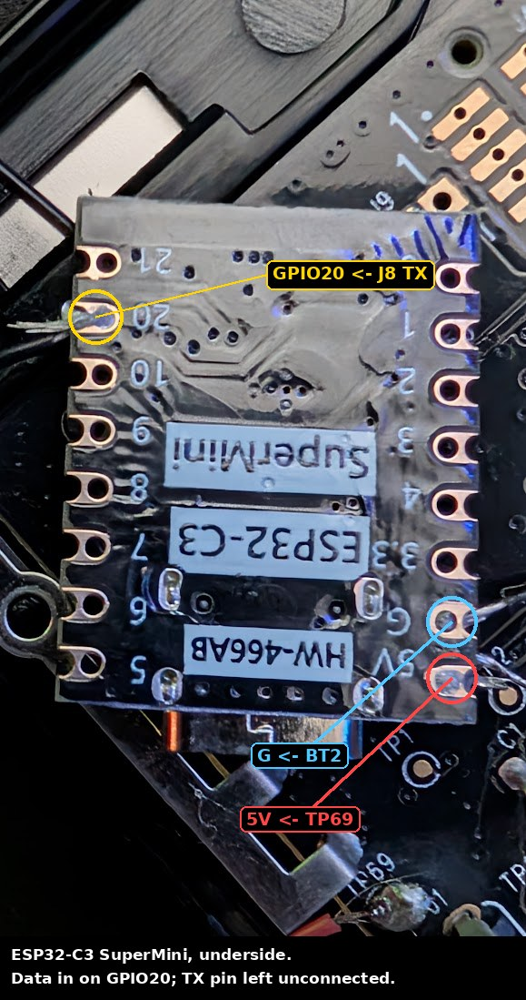

Before powering up, check with the meter: each wire beeps end to end, and **5 V to ground does not beep**.

### Install

The C3 fits in the battery bay. Insulate it **on both sides** (it sits over the IHD's own circuitry), tape over every joint, and hold the wires flat so nothing pulls on J8 when the cover goes on.

| The bay | Installed |
|---|---|
| 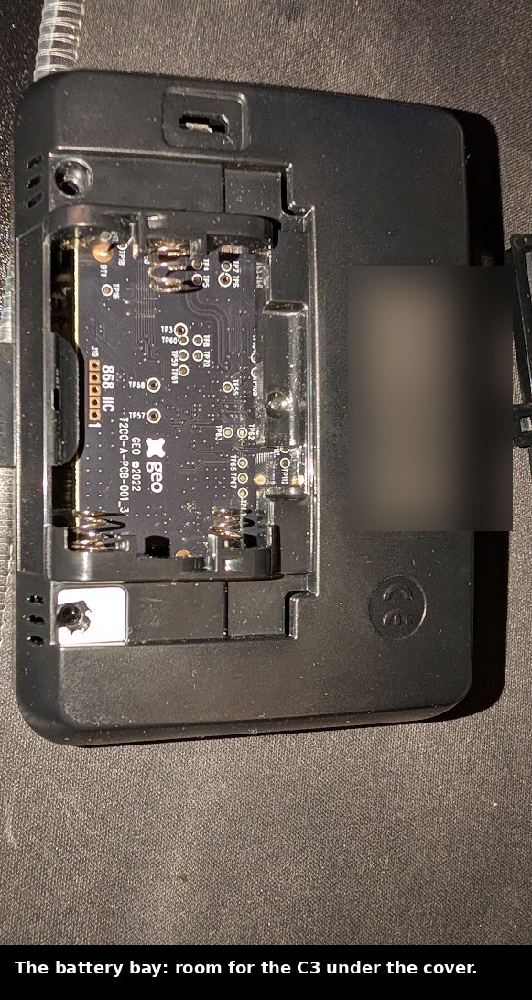 | 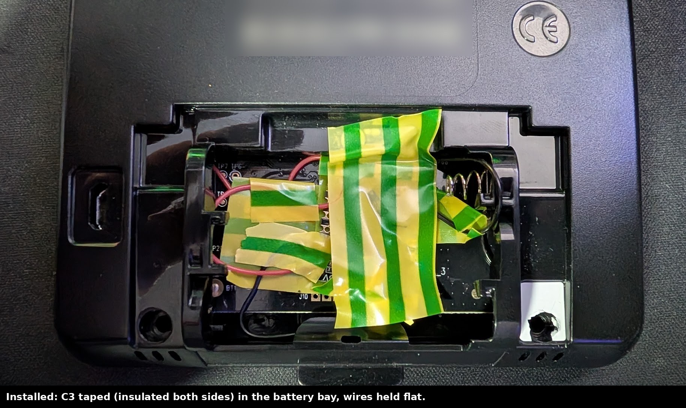 |

The C3 draws about half a watt and runs at about 45–52 °C (its own die temperature) inside the closed case, well within limits.

## The protocol

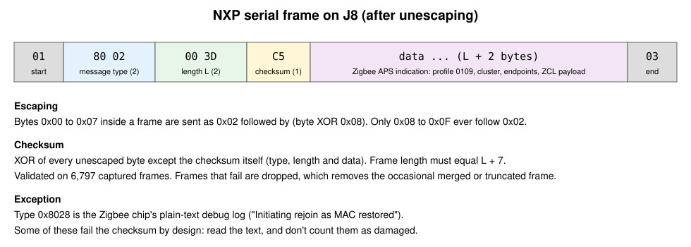

The short version (full reference in [docs/protocol.md](docs/protocol.md)):

- **Frames**: `01` · type (2) · length L (2) · checksum (1) · data (L + 2) · `03`
- **Escaping**: bytes 0x00–0x07 are sent as `02` then `byte XOR 08`
- **Checksum**: XOR of every unescaped byte except itself. Validated on all 6,797 intact frames I captured. Checking it is what removes the "huge bogus readings" people sometimes see: a merged or truncated frame can still contain a pattern a naive parser matches.
- Meter data arrives as message type **0x8002** (Zigbee APS data indication), profile **0x0109** (Smart Energy), carrying ZCL read-attribute responses.

**Endpoints** (on my install):

| Endpoint | Clusters | Contents |
|---|---|---|
| 1 | 0x0702 Metering, 0x0705 Prepayment, 0x0700 Price | electricity readings, costs, tariff |
| 2 | 0x0700 Price | **gas tariff** |
| 3 | 0x0702 Metering, 0x0705 Prepayment | **gas** readings and costs |

Gas readings are on endpoint **3**, not 2.

**Key attributes** (little-endian):

| Attribute | Electricity (ep 1) | Gas (ep 3) | Scale |
|---|---|---|---|
| Meter reading | 0x0702/0x0000 | 0x0702/0x0000 | ÷1000 → kWh / m³ |
| Live power | 0x0702/0x0400 | n/a | W, signed |
| Today | 0x0702/0x0401 | 0x0702/0x0C01 | ÷1000 → kWh |
| Yesterday | 0x0702/0x0403 | 0x0702/0x0C03 | ÷1000 → kWh |
| This month | 0x0702/0x0440 | 0x0702/0x0C40 | ÷1000 → kWh |
| Cost today / yesterday / month | 0x0705/0x051C / 0x051E / 0x0540 | same | ÷100,000 → £ |

The meter also sends **7 days, 5 weeks and 13 months of history** on startup, and its own scaling (divisor 1000; unit kWh for electricity, m³ for gas). See [docs/protocol.md](docs/protocol.md).

Gas readings arrive every couple of minutes but only change every 30 minutes; that's the gas meter's own reporting interval.

## Decoding the tariff

This is the part I haven't seen documented elsewhere. The tariff arrives as **Price cluster (0x0700) commands**, not attributes, in a burst about 15–30 seconds after the IHD powers up, and again **every night shortly after midnight** (00:03–00:10 on my meter).

| Command | Endpoint | Gives | Mine |
|---|---|---|---|
| 0x00 Publish Price | 1 / 2 | unit rate | 26.100p/kWh elec, 7.871p/kWh gas |
| 0x04 Publish Tariff Information | 1 / 2 | standing charge | 60.310p/day elec, 25.499p/day gas |
| 0x02 Publish Conversion Factor | 2 | gas volume correction | 1.02264 |
| 0x03 Publish Calorific Value | 2 | gas CV | 40.3 MJ/m³ |

The easy way in is the currency code: **`3A 03`** (826 = GBP, little-endian). In Publish Price, after the currency come a trailing-digit byte (decimal places in the **high nibble**), a tier byte, a 4-byte start time and a 2-byte duration, then the **price** (uint32). In Publish Tariff Information, the trailing-digit byte is followed directly by the **standing charge** (uint32). Worked examples with real bytes are in [docs/protocol.md](docs/protocol.md#price-cluster-commands).

That gives you gas kWh **from the meter's own figures**: `m³ × 1.02264 × 40.3 ÷ 3.6 = 11.448 kWh/m³` on my supply. Everything above matched my bill.

## The ESPHome firmware

[`firmware/`](firmware/): [`geo-trio-tap.yaml`](firmware/geo-trio-tap.yaml), [`trio_parser.h`](firmware/trio_parser.h) (the decoder), [`trio_known.h`](firmware/trio_known.h) (every message kind seen so far), [`secrets.example.yaml`](firmware/secrets.example.yaml).

Design decisions worth knowing about:

- **Checksum-validated frames only.** Bad frames are counted and logged (with their raw bytes) rather than half-parsed.
- **Tariff from the meter, remembered in flash.** Defaults are only used until the meter's own values arrive; a restart or power cut doesn't lose them. Tariff bursts are debounced (30 s) so Home Assistant sees one update, not six.
- **Midnight rollover.** "Today" values reset at midnight; the last value before the drop is published as "yesterday" straight away, and the meter's own "yesterday" confirms it later (they agreed to within 5 Wh on my first night). Yesterday's values survive a restart, but only if they were saved *today*, so a restart after midnight can't resurrect the wrong day.
- **Gas kWh as a running total.** Each new m³ is converted at the volume correction and calorific value **in force at that moment** and added on. A calorific value change can never rewrite history, so it's safe for the Energy dashboard (see below).
- **Light on the database.** "Today"/"month"/cost sensors only publish when they've moved 10 Wh or 1p, and diagnostics every 5 minutes. Live power and the meter readings stay at full rate (every ~10 s), so the live view keeps pace with the IHD.
- **Gas power estimate.** The meter only reports gas every 30 minutes, so "Gas power" (kW) is worked out from how much the reading moved between reports. It's a half-hour figure, the same thing the IHD's gas cost-per-hour shows, and drops to 0 after 40 minutes with no gas.
- **Tells you when something new happens.** A list of every message kind seen (200 so far); anything new is logged and published to a sensor, with its raw bytes. The Zigbee chip's own status text (type 0x8028) gets its own sensor, so you can see things like `Initiating rejoin as MAC restored` when the IHD briefly loses the meter.
- **Stale-data alarm.** A binary sensor turns on if no reading arrives for 5 minutes.
- **Finds the Zigbee data at a fixed position.** The Smart Energy marker (`01 09`) is always at byte 9 of a meter-data frame. Searching from the start of the frame occasionally matched the checksum and status bytes instead (when they happened to read `01 09`), mis-filing a normal reading as a "new message kind". Fixed by searching from byte 9.

## Home Assistant

Full notes in [docs/home-assistant.md](docs/home-assistant.md). The essentials:

- **Energy dashboard, electricity**: `Electricity meter` (kWh), price from the `Electricity unit rate` sensor, and `Electricity power` for the live view.
- **Energy dashboard, gas**: use **`Gas meter (kWh)`**, the running total, priced with `Gas unit rate`. Don't use a "m³ × current CV" sensor: when the calorific value changes, the whole lifetime total jumps, and Home Assistant reads the drop as a meter reset and double-counts your history.
- **Costs**: the Energy dashboard prices usage only. The C3's "cost today" sensors include standing charges and match the bill. Both are right; they answer different questions.
- **Cost sensors are plain values**, not running totals. They reset daily and monthly, and Home Assistant would read each reset as a refund.

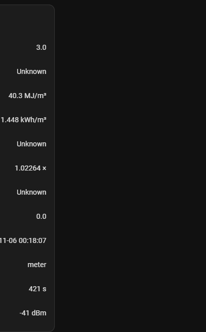

## Things I learned the hard way

- **The `^ 0x08` unescape is correct.** I briefly suspected it should be `^ 0x10`. My captures settled it: only bytes 0x08–0x0F ever follow the `02` escape.
- **"Damaged frames" weren't damaged.** Most of mine turned out to be the Zigbee chip's debug text, which doesn't carry a valid checksum. Logging the raw bytes of each rejected frame is what revealed it.
- **Gas is endpoint 3.** Endpoint 2 only carries the gas tariff.
- **Power the C3 from the IHD.** Then it boots alongside the IHD and catches the startup burst, which is when the tariff and history arrive.
- **Flash saves are batched** (every 5 minutes by default), so a power cut can lose a value received just before. The firmware forces an immediate save for the tariff and yesterday values.
- **ESPHome's "Update queued"** just means the Builder hasn't spotted the device on the network yet. It installs when it does.
- **Search for markers where they live.** Scanning a whole frame for a two-byte marker will eventually match by coincidence: here, a checksum of `01` followed by `09`. If the position is fixed, check the position.
- **The IHD's Zigbee chip can get stuck in a loop.** Once, it logged "Initiating rejoin as MAC restored" several times a second while still delivering readings. Unplugging the IHD for 30 seconds cleared it.

## Open questions

- ~~**Solar export.**~~ **Confirmed** by a solar user in [issue #1](https://github.com/gaza1994/Geo-Trio-ii-tap/issues/1): export is attribute **0x0001** (*CurrentSummationReceived*) on electricity endpoint 1, matching the value the Trio shows (6,700.787 → 6,703.116 kWh while import stood still), and live power **goes negative** while exporting (−2,642 W in their capture). The firmware doesn't publish an export sensor yet: PRs welcome from anyone with solar to test it.
- **Time-of-use tariffs.** Mine is a single rate. Publish Price has tier fields I haven't seen used.
- **Message type 0x8073.** Valid, empty payload, rare. Probably an internal Zigbee stack event.

PRs and captures welcome. [`tools/decode_log.py`](tools/decode_log.py) decodes any capture, and there's a sample in [`samples/`](samples/startup-burst.txt):

```
python3 tools/decode_log.py samples/startup-burst.txt --summary
```

## Credits and licence

- [nadnerb33/geotrio2mqtt](https://github.com/nadnerb33/geotrio2mqtt) for finding J8 and the NXP framing.
- The Zigbee Smart Energy specification (ZCL clusters 0x0700, 0x0702, 0x0705). The serial framing resembles NXP's JN516x host protocol as used by ZiGate; I worked the details (escape, checksum, length) out from captures, so trust the description here over other sources.

MIT licence, see [LICENSE](LICENSE).
