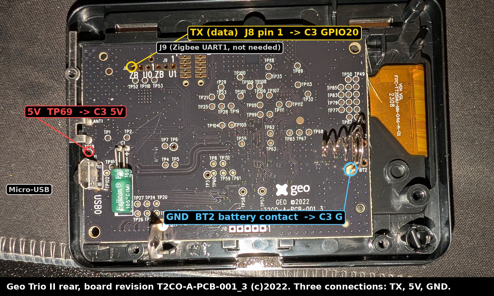
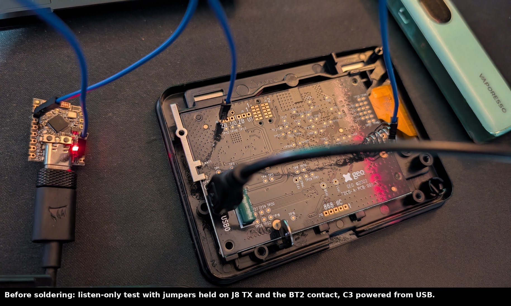
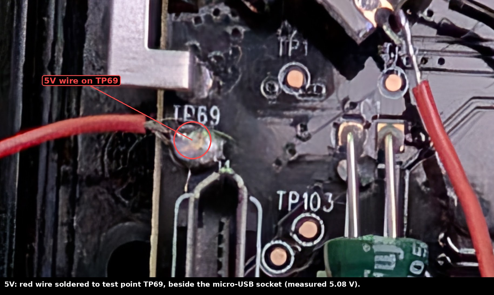
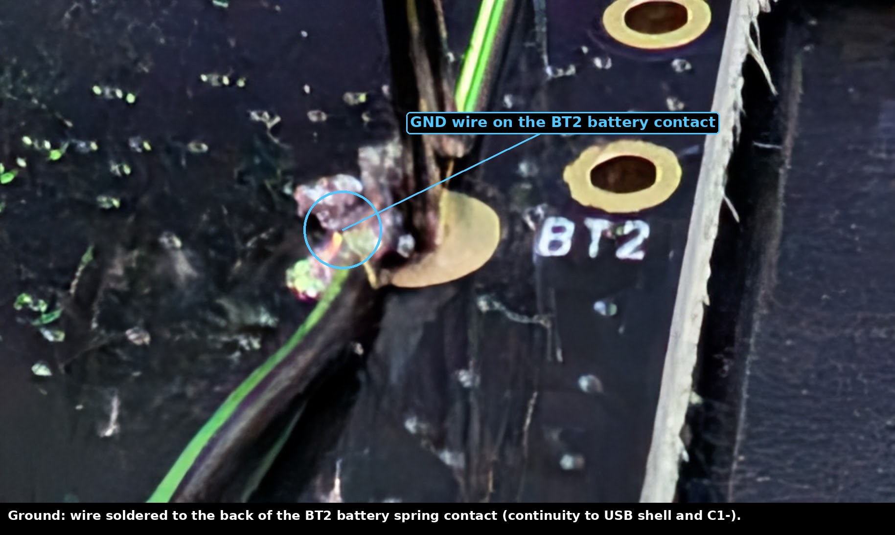
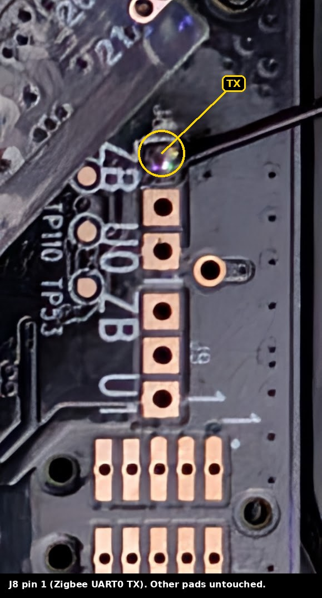
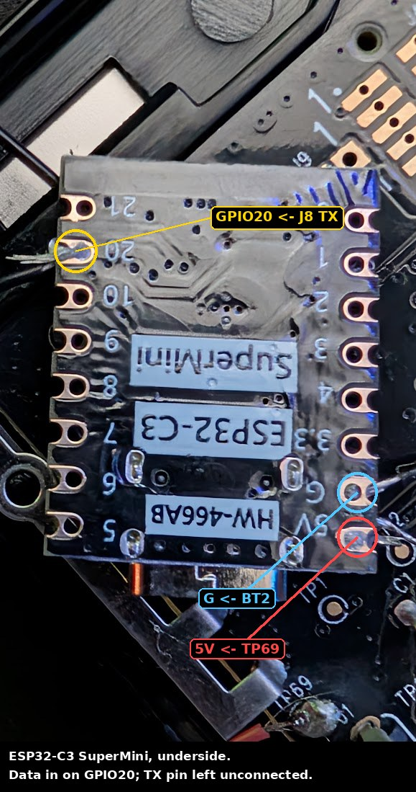
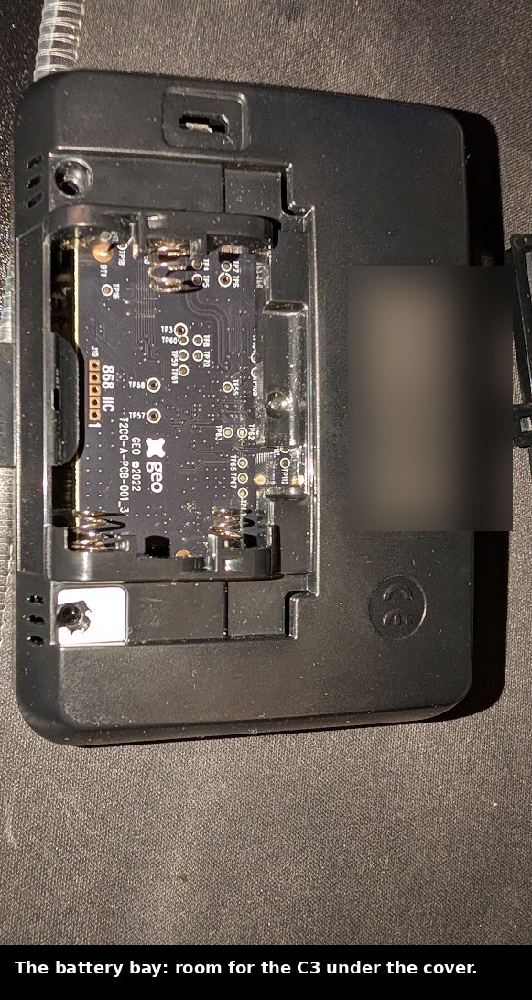
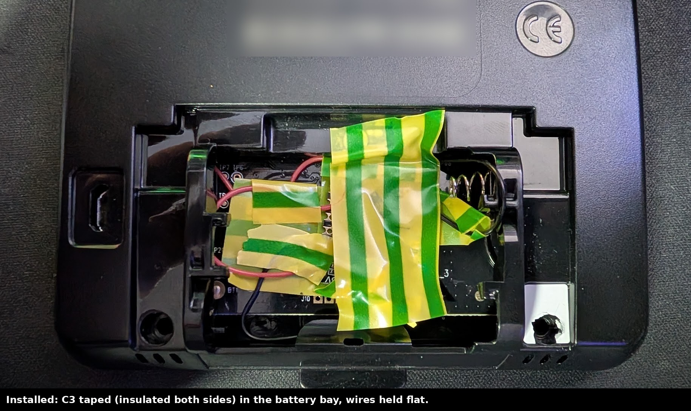
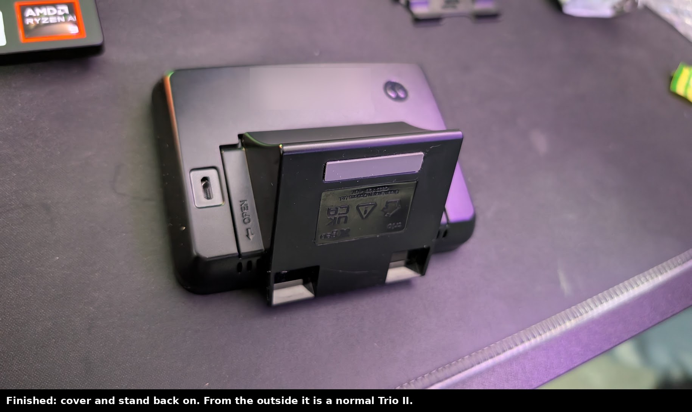

# Hardware: finding the points, testing, soldering, installing

This is for the **2022 board, T2CO-A-PCB-001_3**. If yours says something else, the Zigbee side is probably the same, but measure everything yourself before soldering: test point names and positions can change between revisions.

## Identify your board

Take the battery cover and the back off. The revision is printed on the board near the Geo logo:

```
GEO ©2022
T2CO-A-PCB-001_3
```



Compared with the 2017 board documented by [geotrio2mqtt](https://github.com/nadnerb33/geotrio2mqtt):

| | 2017 board | 2022 board (T2CO-A-PCB-001_3) |
|---|---|---|
| Zigbee chip | NXP JN5169 | NXP JN5169 |
| J8 (Zigbee UART0) | present | present, same position, labelled `ZB U0` |
| WiFi | separate module on a header | **built in** (ESP8285 on the main board) |
| Ground pad near C1 | yes | **no**: use the BT2 battery contact |
| 5 V | — | **TP69**, next to the micro-USB socket |

## Measure

Power the IHD from its micro-USB as normal. Multimeter on DC volts, black probe on ground.

1. **Find ground.** On continuity, the **BT2** battery contact (the spring's solder tab) beeps to the micro-USB socket's metal shell. So does C1's negative leg. I used BT2: it's a big, easy target.
2. **Find 5 V.** **TP69**, the test point just above the micro-USB socket, reads **5.08 V**.
3. **Find TX on J8.** J8 is the group of three pads labelled `ZB U0` near the top edge. Of the three:
   - one reads **0 V** (ground),
   - one reads a **steady 3.3 V**,
   - one reads about **3.3 V but flickers** on the meter's display. That's data. On my board it was **pin 1**, the pad nearest the `J8` label.

A UART idles high and pulls low for each bit, so the data pin shows a slightly-below-3.3 V average that jitters. That's the one you want.

Leave **J9** (`ZB U1`) alone; it's the Zigbee chip's second UART and carries nothing useful here.

## Test without soldering

Before committing, prove you've got the right pad and a working setup.

1. Flash the C3 with [`firmware/stage1-raw-logger.yaml`](../firmware/stage1-raw-logger.yaml) over USB (ESPHome Builder → Install → Plug into this computer).
2. Keep the C3 powered from your computer's USB. Only connect **two** wires to the IHD: C3 **GPIO20** to **J8 TX**, and C3 **G** to **BT2**. Common ground is essential; without it you'll see nothing or garbage.
3. Hold the wires in place (or use thin jumpers pushed into the pads' holes) and watch the ESPHome log. Frames like `<<< 01 80 02 ... 03` should appear within seconds.



To catch the **startup burst** (the tariff and history), restart the IHD while you're logging. Download the log and decode it:

```
python3 tools/decode_log.py my-capture.txt --summary
```

If you see sensible numbers (your meter reading, today's usage), you've got it. Note: loose jumpers cause damaged frames whenever they're nudged. That goes away once soldered.

## Solder

You need three wires: TX, 5 V and ground. 30 AWG silicone wire is flexible enough to route through the battery bay.

- **Practise first** on a spare board or the C3's unused pins.
- **Iron:** a small chisel or bevel tip, not the finest needle tip: a needle can't deliver heat fast enough and you end up holding it on longer. About 350 °C for lead-free solder; the BT2 contact is a heat sink and needs a bit more.
- **Method:** tin the wire, flux the pad, touch, flow, lift. If a joint won't take within about 3 seconds, stop, let it cool, add flux, try again.
- **J8 is the delicate one.** Small pad, quick touch.

| 5 V on TP69 | GND on BT2 | TX on J8 pin 1 |
|---|---|---|
|  |  |  |

On the C3:

| Wire | ESP32-C3 SuperMini pin |
|---|---|
| J8 TX | **GPIO20** |
| TP69 (5 V) | **5V** |
| BT2 (GND) | **G** |



**Leave the C3's TX unconnected.** It's a listener; there's no reason to give it a way to talk to the IHD.

## Check before powering

With everything unplugged, multimeter on continuity:

| Test | Expect |
|---|---|
| J8 TX pad ↔ C3 GPIO20 | beep |
| BT2 ↔ C3 G | beep |
| TP69 ↔ C3 5V | beep |
| C3 5V ↔ C3 G | **no beep** |
| C3 GPIO20 ↔ C3 G | **no beep** |
| C3 GPIO20 ↔ C3 5V | **no beep** |

Probe on the C3's pads, not on the wire, so you're testing the joints.

## Install



The C3 SuperMini fits in the battery bay. It sits over the IHD's own circuitry, so:

1. **Insulate underneath** the C3 (a layer of tape between it and the IHD board) and **over** it.
2. **Tape over every solder joint**, on both boards.
3. **Tape over the battery springs** if you'll never fit batteries.
4. **Hold the wires flat** with small strips of tape, with a little slack so nothing pulls on J8.
5. Put the cover on. If it needs force, something's bulging: rearrange rather than squash.



Kapton tape is the best choice. PVC electrical tape works, but can go gooey over a year or two in the warmth.

## After installing

Flash the full firmware ([`firmware/geo-trio-tap.yaml`](../firmware/geo-trio-tap.yaml)), wirelessly from then on. Check:

- **Damaged frames rejected** stays at **0** apart from the odd one when the IHD boots.
- **Tariff source** says `meter` within a minute of power-up (the C3 boots with the IHD and catches the startup burst).
- **WiFi signal**: the case costs a few dB. Mine reads −57 to −62 dBm.
- **Board temperature**: 45–52 °C in a closed case is normal for the C3's own die temperature.


