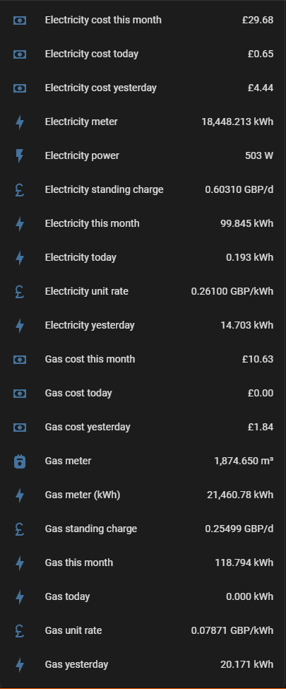
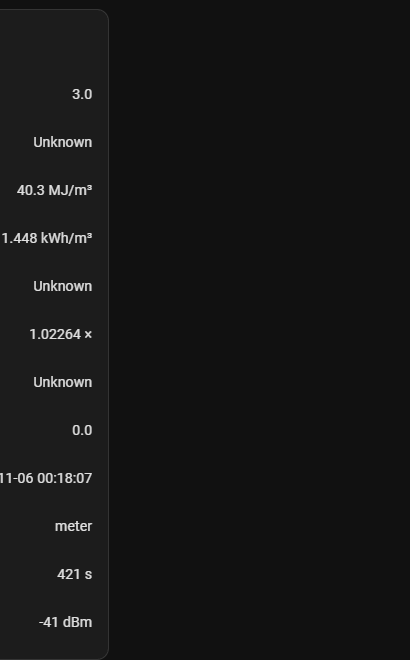

# Home Assistant

The C3 shows up through the ESPHome integration as one device. Everything below assumes the device is called **Geo Trio Tap**, so entities look like `sensor.geo_trio_tap_electricity_meter` (if you put it in an area, HA may prefix the area, e.g. `sensor.kitchen_geo_trio_tap_...`).

## The sensors



| Sensor | Updates | Use it for |
|---|---|---|
| Electricity power | every reading (~10 s) | live draw, cost per hour, alerts, Energy "Now" |
| Electricity meter | every meter tick | **Energy dashboard** (electricity) |
| Electricity today / yesterday / this month | on 10 Wh change | glanceable cards |
| Electricity cost today / yesterday / this month | on 1p change | glanceable cards (**includes standing charge**) |
| Gas meter | every 30 min | the raw m³ reading |
| Gas meter (kWh) | with the gas meter | **Energy dashboard** (gas) |
| Gas power | when the gas reading moves (every 30 min while in use) | estimated gas use in kW over the last half hour; × gas unit rate = cost per hour |
| Gas today / yesterday / this month, gas costs | on 10 Wh / 1p change | glanceable cards |
| Electricity / gas unit rate, standing charge | when the tariff arrives | Energy dashboard prices, sanity checks |
| Gas volume correction, calorific value, kWh per m³ | when the tariff arrives | reference |

Diagnostics:



| Diagnostic | What it tells you |
|---|---|
| Tariff source | `meter` (normal), `default` (no tariff received yet), or `check: calculated rate differs` (the cost-per-kWh worked out from usage disagrees with the stored rate by more than 0.5p: a missed tariff change) |
| Tariff last received | when the meter last sent the tariff (on IHD startup and just after midnight) |
| Electricity / gas unit rate (calculated) | cost change ÷ usage change, over 1 kWh, as a cross-check |
| Damaged frames rejected / Last damaged frame | frames failing the checksum, with their raw bytes. Should stay near zero |
| New message kinds seen / Last new message kind | anything the meter sends that isn't in the known list, with raw bytes |
| IHD status message | the Zigbee chip's own text, e.g. `Initiating rejoin as MAC restored` |
| Meter data stale | on if no reading for 5 minutes (loose wire, IHD crashed, lost the meter) |
| Board temperature, WiFi signal, Uptime | health |

## Energy dashboard

**Settings → Dashboards → Energy:**

**Electricity grid consumption**
- Energy: `Electricity meter`
- Price: *use an entity with current price* → `Electricity unit rate`
- Live power (for the "Now" view): `Electricity power`

**Gas consumption**
- Energy: **`Gas meter (kWh)`**
- Price: *use an entity with current price* → `Gas unit rate`

### Why gas uses the kWh running total

The obvious approach, "gas kWh = m³ × the current conversion factor", breaks the Energy dashboard. Calorific value isn't fixed; it changes from time to time. When it does, a "m³ × current CV" sensor rewrites your *entire lifetime total*. Say it drops from 40.3 to 39.9: the total falls by about 1%, a couple of hundred kWh. Home Assistant treats any fall in a `total_increasing` sensor as a meter reset, and adds the whole total on again: a giant phantom spike in your history.

The firmware avoids this by **accumulating**: every time the gas meter moves, the new m³ is converted at the factor *in force at that moment* and added to a running total stored in flash. A CV change only affects gas used afterwards, which is exactly how you're billed.

If you'd rather use m³ in the Energy dashboard, use `Gas meter` (m³) and price it per m³ (unit rate × kWh per m³). Don't mix the two.

### Costs: Energy dashboard vs the C3's sensors

They'll differ by about the daily standing charges, and both are right:

- **Energy dashboard**: usage × unit rate. No standing charges.
- **C3 "cost today" sensors**: what the meter calculates, **including standing charges**. These match the bill.

## Things that caught me out

### Cost sensors must not be running totals

"Cost today" and "cost this month" reset at midnight and on the 1st. If they're marked as running totals (`state_class: total`), Home Assistant's long-term statistics read every reset as a *refund*. The firmware gives them no state class: they still have history graphs, just no long-term statistics (the Energy dashboard calculates costs itself anyway).

### Switching the Energy dashboard's gas source leaves an orphan

When you price an Energy source with "use an entity with current price", Home Assistant quietly creates a cost tracker for it, e.g. `sensor.geo_trio_tap_gas_meter_cost`. Change the source (say from m³ to kWh) and the old tracker goes `unavailable` but stays. Remove it under **Settings → Entities**, then delete its leftover statistics under **Developer Tools → Statistics → Fix issue**.

### Changing state classes

If you change a sensor's state class after it's been recording, **Developer Tools → Statistics** flags "state class removed". Delete the old statistics there.

### The "Power sources" graph

Giving the grid a live power sensor adds a power-sources graph to the Energy dashboard. Without solar or a battery it's just one line: your live consumption.

## Automations

### Tell me when the meter does something new

The firmware publishes the kind and raw bytes of any message it hasn't seen before. This notifies you once per new kind:

```yaml
alias: Geo Trio - New meter message kind
mode: queued
max: 10
triggers:
  - trigger: state
    entity_id: sensor.geo_trio_tap_last_new_message_kind
conditions:
  - condition: template
    value_template: >-
      {{ trigger.to_state.state not in ['unknown', 'unavailable', '']
         and (trigger.from_state is none or trigger.from_state.state != trigger.to_state.state) }}
actions:
  - variables:
      kind: "{{ trigger.to_state.state.split(' ')[0] }}"
      raw: "{{ trigger.to_state.state.split(' ')[1:] | join(' ') }}"
  - action: notify.mobile_app_your_phone
    data:
      title: Meter sent something new
      message: "Geo Trio tap saw a new message kind: {{ kind }}"
  - action: persistent_notification.create
    data:
      notification_id: "geo_trio_new_{{ kind }}"
      title: "Geo Trio: new message kind {{ kind }}"
      message: |-
        Seen {{ now().strftime('%Y-%m-%d %H:%M:%S') }}.

        Raw frame (unescaped hex):
        `{{ raw }}`
```

### The meter's data has gone stale

```yaml
alias: Geo Trio - Meter data stale
triggers:
  - trigger: state
    entity_id: binary_sensor.geo_trio_tap_meter_data_stale
    to: "on"
    for: "00:05:00"
actions:
  - action: notify.mobile_app_your_phone
    data:
      title: Smart meter data stopped
      message: No readings from the Geo Trio tap for 10 minutes.
```

### Big draw while nobody's home

```yaml
alias: Electricity - High draw while away
triggers:
  - trigger: numeric_state
    entity_id: sensor.geo_trio_tap_electricity_power
    above: 2500
    for: "00:05:00"
conditions:
  - condition: state
    entity_id: zone.home
    state: "0"
actions:
  - action: notify.mobile_app_your_phone
    data:
      message: "Nobody's home but the house is drawing {{ states('sensor.geo_trio_tap_electricity_power') | int }} W."
```

## Keeping the database lean

At full rate, a tap like this is easily the biggest writer to Home Assistant's database: on mine, seven sensors were updating together on every watt-hour, about 55,000 rows a day, over half of everything the house recorded. Most of that was the same information seven ways, so the firmware filters the glanceable sensors:

```yaml
filters: [ { delta: 0.01 } ]             # today / month (10 Wh) and costs (1p)
update_interval: 5min                    # uptime, WiFi signal
```

Live power and the meter readings stay at full rate. (I tried a 30-second average on live power too; it saves more, but the dashboard then lags the IHD by up to half a minute. With 30 days of history the extra rows are nothing to worry about.) The filtered sensors always show the meter's true value (they publish less often, they don't round), so nothing drifts.

### Cost per hour, like the IHD

A Mushroom template card's secondary line, for example:

```jinja

{{ '£%.2f' | format(w / 1000 * states('sensor.geo_trio_tap_electricity_unit_rate') | float(0)) }}/hour
```

For gas, use `Gas power` (kW) × `Gas unit rate`. Like the IHD, this excludes the standing charge.
